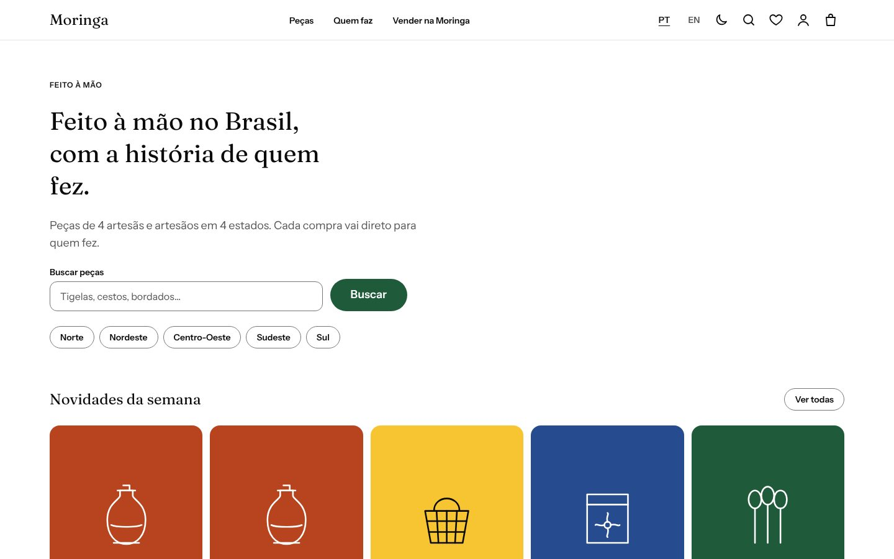
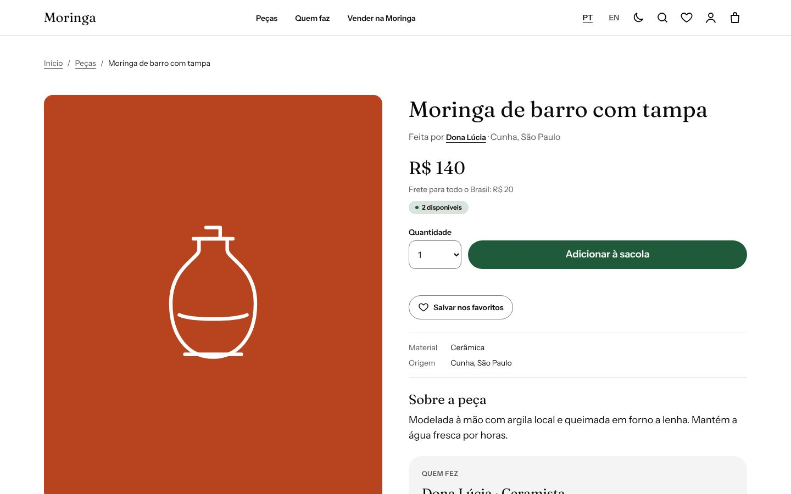
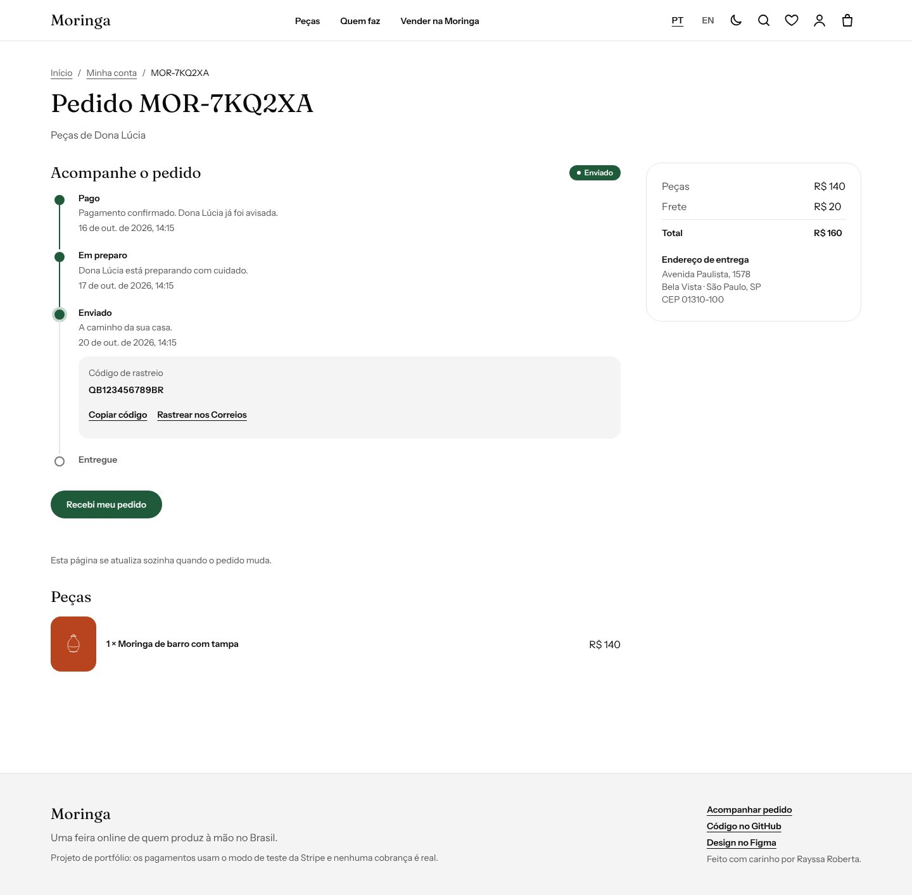
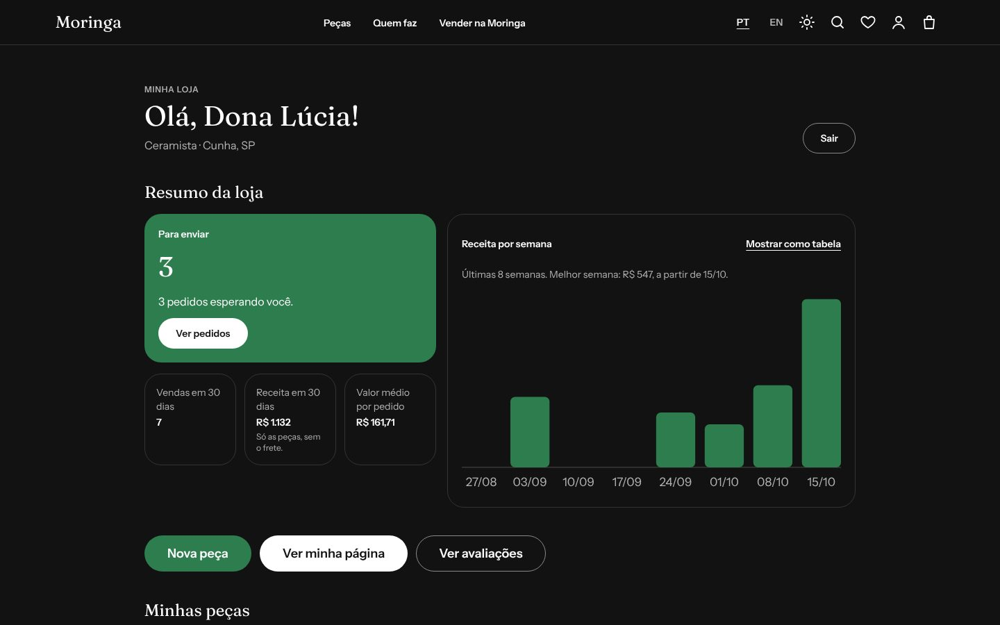
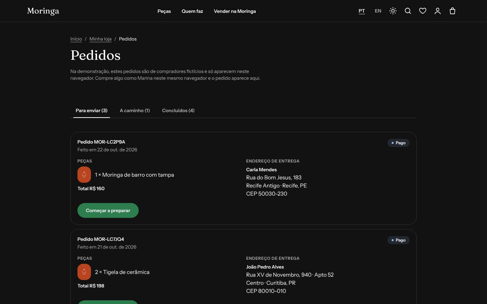
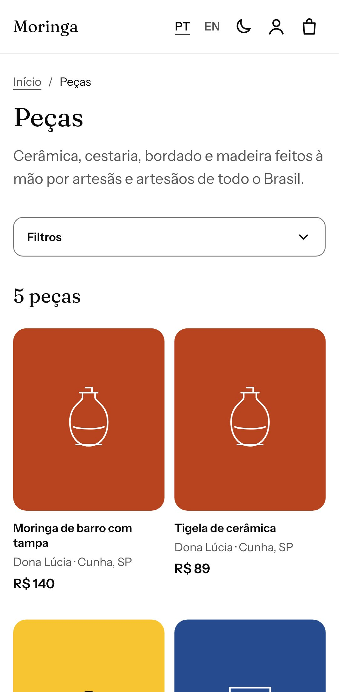
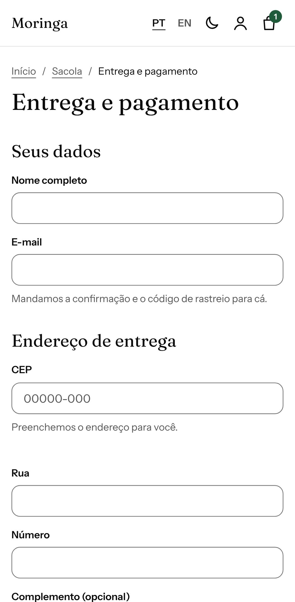

<div align="center">

# 🏺 Moringa

**Uma feira online de quem produz à mão no Brasil.**

**[Abrir o site](https://moringa-silk.vercel.app/pt)** · [English](./README.md) · **Português**

[](https://github.com/rayssarrsilva/Moringa/actions/workflows/ci.yml)
[](https://github.com/rayssarrsilva/Moringa/actions/workflows/codeql.yml)
[-2e7d4f>)](https://developer.mozilla.org/en-US/observatory/analyze?host=moringa-silk.vercel.app)
[](https://securityheaders.com/?q=https%3A%2F%2Fmoringa-silk.vercel.app%2F&followRedirects=on)
[](./LICENSE)



</div>

---

## Por que "Moringa"?

A moringa é o pote de barro feito à mão que mantém a água fresquinha. Em muita casa brasileira, é dela que sai o copo d'água oferecido a quem chega. Este projeto carrega a mesma ideia: acolher as pessoas e dar espaço para as mãos por trás de cada peça.

## O que é

Uma feira com dois lados, cada um com seu painel:

- **Quem compra** encontra peças por região, material e preço, lê a história de quem fez, salva favoritos, paga pela Stripe (modo de teste, cartão ou Pix), acompanha cada etapa do pedido e avalia o que chegou.
- **Quem produz** abre a loja com a sua história, cadastra peças num formulário guiado, edita ou pausa cada uma, vê as vendas e despacha os pedidos. Quando adiciona o código de rastreio, quem comprou vê na hora.

Tudo funciona em português e inglês, nos temas claro e escuro, no celular e no computador, pelo teclado ou com leitor de tela.

Feita com o [Ipê Design System](https://github.com/rayssarrsilva/Ipe), também meu.

## Experimente

Sem cadastro: cada conta de demonstração é um clique, e o que você fizer fica só no seu navegador por 7 dias.

| Quem                      | Onde                                                  | O que testar                                                                                                    |
| ------------------------- | ----------------------------------------------------- | --------------------------------------------------------------------------------------------------------------- |
| **Marina**, compradora    | [/pt/conta](https://moringa-silk.vercel.app/pt/conta) | Pedidos em todas as etapas, a linha do tempo ao vivo, "Recebi meu pedido", avaliações                           |
| **Dona Lúcia**, ceramista | [/pt/loja](https://moringa-silk.vercel.app/pt/loja)   | Gráfico de vendas (com versão em tabela), despachar um pedido com código de rastreio, editar ou pausar uma peça |
| **Uma loja nova**         | [/pt/loja](https://moringa-silk.vercel.app/pt/loja)   | Abrir uma loja do zero e publicar a primeira peça                                                               |
| **Qualquer pessoa**       | [/pt/pecas](https://moringa-silk.vercel.app/pt/pecas) | Filtrar, pôr na sacola e pagar com o cartão de teste `4242 4242 4242 4242`, qualquer data futura e CVC          |

## Qualidade em números

Medido no site no ar e em todo pull request. Última conferência em 22 de outubro de 2026.

| Área                          | Resultado                                                                                                                                                                                                                                                             | Como é verificado                                                                                                  |
| ----------------------------- | --------------------------------------------------------------------------------------------------------------------------------------------------------------------------------------------------------------------------------------------------------------------- | ------------------------------------------------------------------------------------------------------------------ |
| Performance                   | Lighthouse 90–100 no celular (4G lento simulado)                                                                                                                                                                                                                      | [Lighthouse CI](./lighthouserc.cjs), 4 páginas × 3 rodadas, em todo PR                                             |
| Acessibilidade                | Lighthouse 100 · 0 violações no axe · WCAG 2.2 AA                                                                                                                                                                                                                     | axe em todas as páginas nos dois temas, mais testes de teclado e foco no Playwright; leitor de tela no ciclo de QA |
| SEO                           | Lighthouse 100                                                                                                                                                                                                                                                        | hreflang, canonical, imagens de Open Graph, sitemap, JSON-LD de produto e avaliações                               |
| Cabeçalhos de segurança       | [Mozilla Observatory **A+** (135/100, 12/12 testes)](https://developer.mozilla.org/en-US/observatory/analyze?host=moringa-silk.vercel.app) · [securityheaders.com **A+**](https://securityheaders.com/?q=https%3A%2F%2Fmoringa-silk.vercel.app%2F&followRedirects=on) | Ferramentas externas, no site no ar                                                                                |
| Varredura de vulnerabilidades | OWASP ZAP baseline: 0 alto · 0 médio · 0 baixo                                                                                                                                                                                                                        | [Plano do ZAP](./.zap/baseline.yaml) em todo PR                                                                    |
| Código e dependências         | CodeQL `security-extended` · `npm audit`: 0 vulnerabilidades                                                                                                                                                                                                          | [CodeQL](./.github/workflows/codeql.yml), Dependabot                                                               |
| Testes                        | 173 unitários e de integração · 150 ponta a ponta (celular e desktop)                                                                                                                                                                                                 | Vitest, PGlite (Postgres de verdade), Playwright                                                                   |

## Telas

|                                                                                                                                                                                                                   |                                                                                                                                                                                                                        |
| :---------------------------------------------------------------------------------------------------------------------------------------------------------------------------------------------------------------: | :--------------------------------------------------------------------------------------------------------------------------------------------------------------------------------------------------------------------: |
| <br>Página da peça, com a história de quem fez | <br>Linha do tempo do pedido, ao vivo |
|    <br>Painel da loja, tema escuro    |                              <br>Pedidos para enviar                               |
|                                     <br>Catálogo no celular                                     |                             <br>Checkout no celular                              |

## Descoberta

Os documentos de descoberta estão em inglês, o idioma mais usado em times de produto:

- [Brief do produto](./docs/discovery/BRIEF.md)
- [Personas](./docs/discovery/PERSONAS.md)
- [Backlog com critérios de aceite](./docs/discovery/BACKLOG.md)
- [Mapa de requisitos de vaga](./docs/discovery/JOB-REQUIREMENTS.md)
- [FigJam: jornadas, ciclo do pedido e mapa do site](https://www.figma.com/board/Hfz7wLzJGGltovUDZtSSAc)

## Design

- [Wireframes com notas de UX](https://www.figma.com/design/vp371wwKQRWh4elNOk1S1D)
- [Telas finais e protótipo clicável](https://www.figma.com/design/o3irY2VOsGjlLt3fiAPTU0), feitos só com componentes do Ipê
- [Decisões de design](./docs/design/README.md) (em inglês)

## Stack

| Camada             | Ferramentas                                                                                 |
| ------------------ | ------------------------------------------------------------------------------------------- |
| App                | Next.js 16 (App Router, Server Components, Server Actions) · React 19 · TypeScript (strict) |
| Interface          | Ipê Design System 2.0 · Tailwind CSS 4 · next-intl (pt-BR, en)                              |
| Dados              | Postgres no Neon · Drizzle ORM com migrações versionadas · TanStack Query · Zustand         |
| Formulários        | React Hook Form · Zod (o mesmo schema no navegador e no servidor)                           |
| Login e pagamentos | Auth.js v5 (JWT) · Stripe Checkout em modo de teste (cartão e Pix) com webhook assinado     |
| Qualidade          | Vitest · Testing Library · PGlite · Playwright · axe · Lighthouse CI · OWASP ZAP · CodeQL   |
| Entrega            | GitHub Actions · Dependabot · Vercel                                                        |

## Rodando na sua máquina

Requer Node.js 22 (veja `.nvmrc`).

```bash
npm install
cp .env.example .env.local   # depois preencha o DATABASE_URL da Neon
npm run db:migrate           # cria ou atualiza as tabelas
npm run db:seed              # adiciona as artesãs, os artesãos e as peças de demonstração
npm run dev                  # http://localhost:3000
```

| Comando             | O que faz                                                                                       |
| ------------------- | ----------------------------------------------------------------------------------------------- |
| `npm test`          | Testes unitários e de componente (Vitest + Testing Library)                                     |
| `npm run test:e2e`  | Testes de ponta a ponta e de acessibilidade com axe no Chromium, celular e desktop (Playwright) |
| `npm run lint`      | ESLint sem nenhum aviso permitido                                                               |
| `npm run typecheck` | TypeScript em modo estrito                                                                      |
| `npm run build`     | Build de produção                                                                               |

### Sem banco de dados

Sem o `DATABASE_URL`, o app roda com o catálogo de exemplo embutido. A CI usa esse modo, então os testes nunca dependem de um banco no ar.

### API do catálogo

`GET /api/pieces` aceita os mesmos parâmetros da página do catálogo, por exemplo `/api/pieces?regiao=nordeste&material=palha&preco_max=150&ordem=menor-preco`. `GET /api/pieces/{slug}` devolve uma peça, ou um 404 em JSON.

### Conta de demonstração

A área de quem compra, em `/pt/conta`, tem login de demonstração com um clique como **Marina**, com pedidos em todos os estados (pago, enviado com código de rastreio, entregue). Não há senha: o login de demonstração só vê dados de demonstração. Na Vercel, defina `AUTH_SECRET` (gere um com `npx auth secret`).

### Migrações do banco

O schema fica em `src/db/schema.ts`. Depois de mudar, rode `npm run db:generate` e commite o arquivo novo em `drizzle/`. A CI falha se o schema e as migrações não baterem (`npm run db:check`).

Todo build na Vercel roda `npm run db:migrate` antes do `next build`, então o banco sempre acompanha o código que está subindo. As migrações só acrescentam (primeiro adiciona, remove numa versão seguinte), para o site no ar continuar funcionando durante o deploy. Os primeiros bancos foram criados com `db:push`; o script percebe isso e registra o ponto de partida em vez de recriar as tabelas.

### Testes

- `npm test` roda testes unitários, de componente e de integração com banco. Os de integração sobem um Postgres de verdade em memória com o [PGlite](https://pglite.dev), criam o schema a partir de `src/db/schema.ts` e rodam as mesmas queries do Drizzle que o app manda para o Neon.
- `npm run test:e2e` roda o Playwright no celular e no desktop, com checagem de acessibilidade do axe nos dois temas.
- `npm run lhci` gera o build e roda o [Lighthouse CI](https://github.com/GoogleChrome/lighthouse-ci) três vezes em quatro páginas (início, catálogo, peça e loja em inglês). O pull request falha abaixo destas notas (resultados atuais em [Qualidade em números](#qualidade-em-números)):

| Performance | Acessibilidade | Boas práticas | SEO |
| :---------: | :------------: | :-----------: | :-: |
|    ≥ 90     |      100       |     ≥ 95      | 100 |

### Pagamentos (modo de teste da Stripe)

Sem `STRIPE_SECRET_KEY`, o checkout roda como demonstração e vai direto para a confirmação. Para testar o fluxo de verdade:

1. Crie uma conta na Stripe, fique no **modo de teste** e copie a chave secreta (`sk_test_…`) para o `.env.local`. Chaves de produção são recusadas de propósito.
2. Em Dashboard → Settings → Payment methods, ative **Cards** e **Pix**.
3. Rode `stripe listen --forward-to localhost:3000/api/stripe/webhook` e copie o segredo `whsec_…` para `STRIPE_WEBHOOK_SECRET`.
4. Pague com o cartão de teste `4242 4242 4242 4242`, qualquer data futura e qualquer CVC. Use `4000 0000 0000 0002` para ver um cartão recusado.

Cada artesã recebe o seu próprio pedido. Os pedidos nascem como `pending` e o webhook leva para `paid` (cartão na hora, Pix quando o banco confirma) ou `canceled` (Pix expirado), seguindo o ciclo de vida do pedido no FigJam.

### Fluxo de trabalho

- Toda mudança passa por uma branch e um pull request. O CI roda lint, tipos, testes unitários, build, E2E, Lighthouse, a varredura do ZAP, `npm audit` e CodeQL em cada um.
- As mensagens de commit seguem o [Conventional Commits](https://www.conventionalcommits.org/pt-br) e são verificadas pelo commitlint.
- O trabalho é planejado no [quadro do projeto](https://github.com/users/rayssarrsilva/projects/4) em sprints de uma semana.

## Segurança

Feito com base no [OWASP Top 10](https://owasp.org/Top10/) e no [ASVS nível 2](https://owasp.org/www-project-application-security-verification-standard/). O [modelo de ameaças](./docs/security/THREAT-MODEL.md) lista cada risco, o que o impede e onde isso está no código.

- **Content Security Policy com um nonce novo a cada requisição.** Só rodam os scripts daquela resposta: nada de script inline, `eval`, outras origens ou o site dentro de um iframe.
- **HSTS (preload), `nosniff`, `Referrer-Policy`, `Permissions-Policy` e `Cross-Origin-Opener-Policy`** em todas as páginas, rotas da API e arquivos.
- **Limite de tentativas** no login, no checkout, no acompanhamento de pedido sem conta e em toda escrita, guardado no Postgres para valer entre as instâncias serverless. O visitante é identificado por um hash do IP com sal, nunca pelo IP.
- **Checagem de origem** em toda rota POST, além dos cookies `SameSite` e da checagem que o Next.js já faz nas Server Actions.
- **Regras no servidor:** preço recalculado, dono conferido em toda consulta, uma única máquina de estados do pedido, webhook da Stripe assinado e idempotente.
- **Cadeia de dependências:** CodeQL, Dependabot, `npm audit` na CI, GitHub Actions fixadas por commit e token dos workflows só de leitura.
- Achou um problema? Veja o [SECURITY.md](./SECURITY.md) ou o [`/.well-known/security.txt`](https://datatracker.ietf.org/doc/html/rfc9116).

| Verificação                                                                                                                   | Resultado                          |
| ----------------------------------------------------------------------------------------------------------------------------- | ---------------------------------- |
| [Mozilla HTTP Observatory](https://developer.mozilla.org/en-US/observatory/analyze?host=moringa-silk.vercel.app), site no ar  | **A+** · 135/100 · 12 de 12 testes |
| [securityheaders.com](https://securityheaders.com/?q=https%3A%2F%2Fmoringa-silk.vercel.app%2F&followRedirects=on), site no ar | **A+**                             |
| Varredura baseline do [OWASP ZAP](https://www.zaproxy.org), em todo pull request                                              | 0 alto · 0 médio · 0 baixo         |
| `npm audit` (dependências de produção)                                                                                        | 0 vulnerabilidades                 |
| Violações de CSP no navegador (Playwright)                                                                                    | 0                                  |

## Autora

Feito com carinho por **Rayssa Roberta** · [LinkedIn](https://www.linkedin.com/in/rayssa-r-14936622a) · [Portfólio](https://portfoliorayssarrsilva.site)

## Licença

[MIT](./LICENSE)
